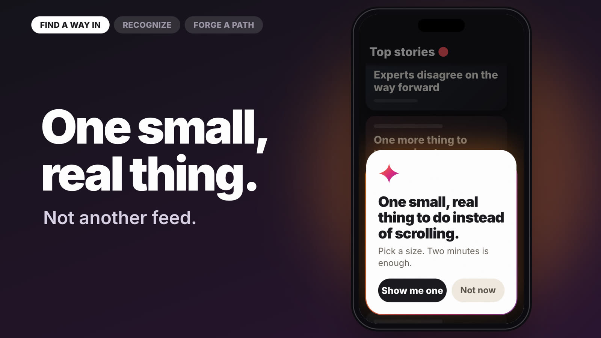
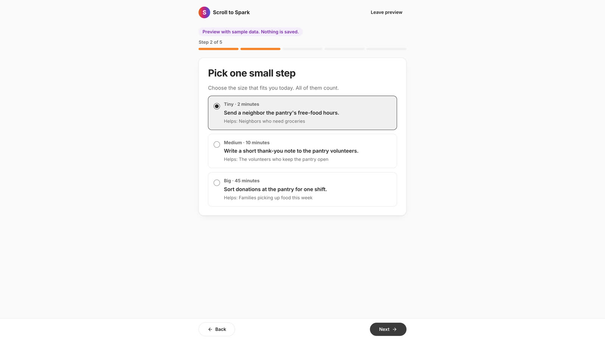
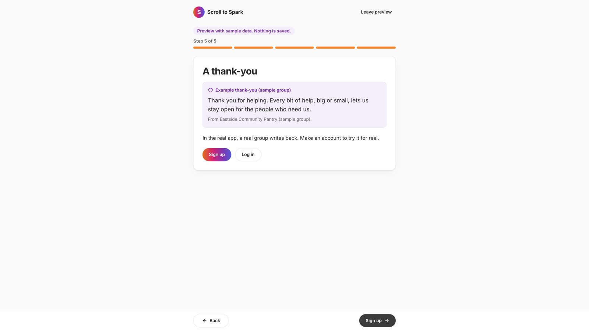
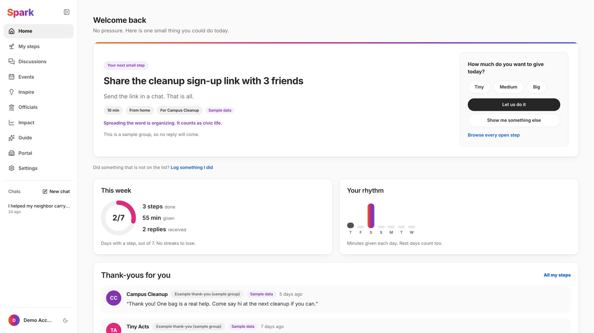
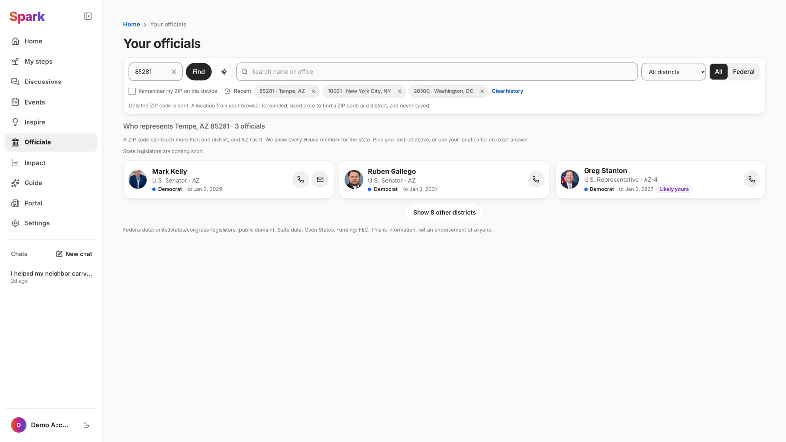
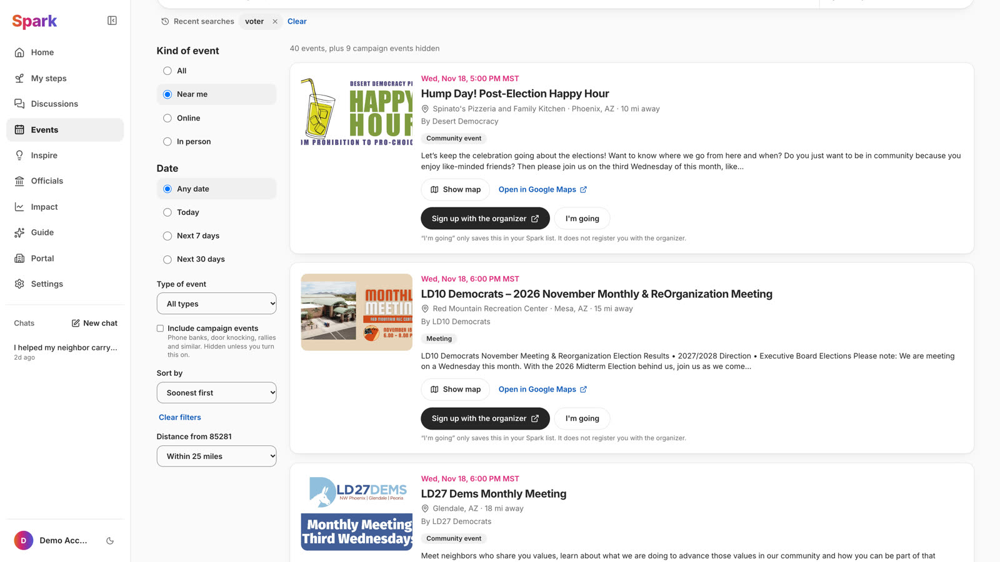
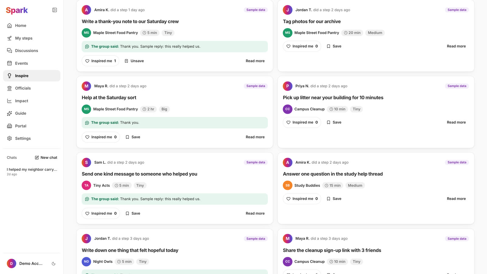
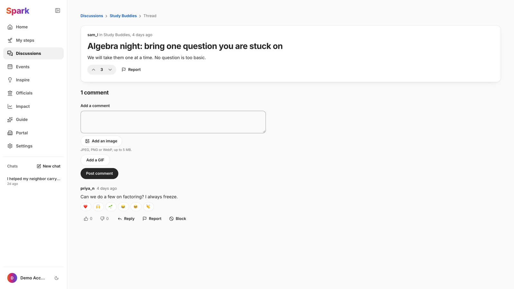
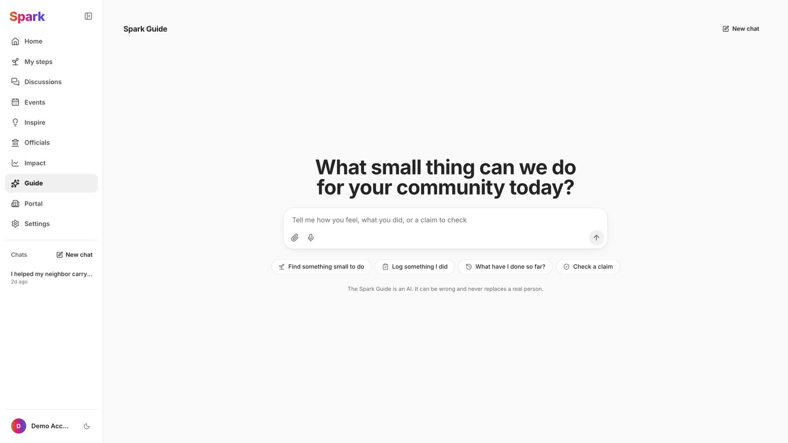

<div align="center">

<h1>Scroll to Spark</h1>

<p><strong>When the news feels heavy, one small, real thing to do.</strong><br/>
Pick a size, take a step, and see who wrote the thank-you back.</p>

<p>
  <a href="https://scroll-to-spark.vercel.app"><strong>Live site</strong></a>
  &nbsp;|&nbsp;
  <a href="https://scroll-to-spark.vercel.app/demo.mp4"><strong>Watch the 2-minute demo</strong></a>
  &nbsp;|&nbsp;
  <a href="https://scroll-to-spark.vercel.app/try"><strong>Try it without signing up</strong></a>
</p>

<a href="https://scroll-to-spark.vercel.app/demo.mp4">
  
</a>

<p><sub>Working prototype by Group 14, ASU Principled Innovation Academy. Works in any browser and on your phone.</sub></p>

</div>

---

## Table of contents

1. [Overview](#overview)
2. [The problem](#the-problem)
3. [How it works](#how-it-works)
4. [Features](#features)
5. [Screenshots](#screenshots)
6. [Responsible by design](#responsible-by-design)
7. [Tech stack](#tech-stack)
8. [Getting started](#getting-started)
9. [Environment variables](#environment-variables)
10. [Project structure](#project-structure)
11. [Quality and testing](#quality-and-testing)
12. [Data sources](#data-sources)
13. [Documentation](#documentation)
14. [Status and roadmap](#status-and-roadmap)
15. [Team](#team)

---

## Overview

Scroll to Spark turns a heavy scrolling moment into one small action for your community, then shows you a real thank-you from the group you helped.

It was built for the Principled Innovation Academy challenge:

> How might we help people recognize the ways they contribute, find new avenues to participate, and forge meaningful paths for change within the communities they care about?

| For                            | What they get                                                                                  |
| ------------------------------ | ---------------------------------------------------------------------------------------------- |
| **People who care but scroll** | One small step at a time, sized to the time they have, with who it helps stated up front       |
| **Community groups**           | A portal to post small tasks and send thank-yous back to the people who showed up              |
| **Everyone**                   | Representatives, events, discussions and shared ideas in one place, in a browser or on a phone |

Adults aged 18 and over. The target audience is ages 18 to 24.

## The problem

Many people care about their community, and most never act on it through an organization.

In 2023, 54.2% of Americans helped or exchanged favors with neighbors, but only 28.3% formally volunteered through an organization. We call that distance the **doomscroll gap**: people care, and nothing asks them to act.

> Source: U.S. Census Bureau and AmeriCorps, Civic Engagement and Volunteering Supplement, September 2022 to September 2023, people aged 16 and over. See [Data sources](#data-sources).

## How it works

| Step               | What happens                                                                                                                                 |
| ------------------ | -------------------------------------------------------------------------------------------------------------------------------------------- |
| **1. Pause**       | A kind prompt at a heavy moment: "Want to do one small thing instead?" No guilt.                                                             |
| **2. Pick a size** | **Tiny** is about 2 minutes, **Medium** about 10, **Big** about 45. Every step shows its time and who it helps.                              |
| **3. Get thanked** | A group can reply with a thank-you. Every reply shows who wrote it. Your steps add up in a private view with no streaks and no leaderboards. |

## Features

| Area               | What you can do                                                                                                                                         |
| ------------------ | ------------------------------------------------------------------------------------------------------------------------------------------------------- |
| **Small steps**    | Browse steps by size and place, add a note, mark one done, and log things you did that are not on the list                                              |
| **Thank-yous**     | Receive one-tap or written replies from groups, always labelled by who wrote them                                                                       |
| **Progress**       | A private "This week" card and a day-by-day rhythm. No streaks, no points                                                                               |
| **Discussions**    | Create and join groups, post threads with images and GIFs, vote, reply in nested comments, react with emoji, and use report, block and group rules      |
| **Events**         | Search civic events near a ZIP code, filter by type and date, save "I'm going", and track what you attended. Campaign-work events are hidden by default |
| **Your officials** | Enter a ZIP code to see your senators, House member and state legislators, with contact links and a funding summary                                     |
| **Get inspired**   | An opt-in feed of steps other people chose to share, with search, filters, saves and reactions. Sharing is off by default                               |
| **Your impact**    | A clearly labelled sample of how groups could show what changed, before and after                                                                       |
| **Partner portal** | Groups post small tasks, see who completed them, and send thank-yous                                                                                    |
| **Spark Guide**    | An AI helper that points to open tasks and says it is an AI. It can be wrong, and says so                                                               |
| **Profile**        | Edit your name, username and photo with a crop-and-preview editor                                                                                       |

Works as a responsive website on laptops and phones. It is not an app-store app.

## Screenshots

Real screens from the running prototype, using sample data that the app labels as such.

<table>
  <tr>
    <td width="50%"><br/><sub><strong>Pick a size</strong>: Tiny, Medium or Big, each with its time</sub></td>
    <td width="50%"><br/><sub><strong>Get thanked</strong>: an example reply, labelled as a sample</sub></td>
  </tr>
  <tr>
    <td width="50%"><br/><sub><strong>Home</strong>: your next step and private progress</sub></td>
    <td width="50%"><br/><sub><strong>Your officials</strong>: who represents you, from public data</sub></td>
  </tr>
  <tr>
    <td width="50%"><br/><sub><strong>Events</strong>: civic events near you</sub></td>
    <td width="50%"><br/><sub><strong>Get inspired</strong>: what others chose to share</sub></td>
  </tr>
  <tr>
    <td width="50%"><br/><sub><strong>Discussions</strong>: threads with report and block</sub></td>
    <td width="50%"><br/><sub><strong>Spark Guide</strong>: an AI helper, labelled as AI</sub></td>
  </tr>
</table>

## Responsible by design

- **Adults only.** Account setup includes an 18+ confirmation.
- **Private by default.** What you write stays private unless you choose to share a step. Sharing shows a first name, a last initial and your profile photo.
- **Honest labels.** Sample content is marked **Sample**. A thank-you always shows who wrote it. The AI guide is labelled as an AI and its answers are grounded in the app's own data.
- **Safety tools.** Report and block on threads, comments and shared steps. Posts are hidden after repeated reports. Group rules and rate limits are built in.
- **No pressure.** No points, no streaks, no leaderboards.
- **Database-enforced access.** Row Level Security is on every table, so the database decides who can read, write and delete.
- **Crisis wording.** Messages that signal a crisis are handled separately and are never saved.

## Tech stack

| Area              | Choice                                                                                              |
| ----------------- | --------------------------------------------------------------------------------------------------- |
| Framework         | Next.js 16 (App Router), React 19, TypeScript                                                       |
| Styling           | Tailwind CSS 4, design tokens, Inter variable font                                                  |
| Database and auth | Supabase (Postgres, Auth, Storage) with Row Level Security                                          |
| Validation        | Zod 4 on every form and server action                                                               |
| AI helper         | OpenRouter free models by default, with Cerebras and Groq as failover, called from server code only |
| Hosting           | Vercel, deployed automatically from `main`                                                          |
| Testing           | Vitest                                                                                              |

Full detail and the reasons for each choice are in [docs/TECH_STACK.md](docs/TECH_STACK.md).

## Getting started

### Prerequisites

- Node.js 20.9 or newer
- A Supabase project (the free tier is enough)

### Install and run

```bash
git clone https://github.com/Rudheer127/scroll-to-spark.git
cd scroll-to-spark
npm install
cp .env.example .env.local
npm run dev
```

Open <http://localhost:3000>.

### Set up the database

Apply every SQL file in [`supabase/migrations`](supabase/migrations) to your Supabase project in filename order, using the Supabase CLI or the SQL editor. The first migrations create the tables and policies, and later ones add features such as events, officials history and the inspiration feed.

### Useful commands

| Command             | What it does                                       |
| ------------------- | -------------------------------------------------- |
| `npm run dev`       | Start the development server                       |
| `npm run build`     | Build for production                               |
| `npm test`          | Run the unit tests                                 |
| `npm run lint`      | Check code style                                   |
| `npm run typecheck` | Check types                                        |
| `npm run format`    | Format the code                                    |
| `npm run eval:live` | Run the live AI safety eval (needs a provider key) |

## Environment variables

Copy `.env.example` to `.env.local` and fill it in. Never commit real values.

| Variable                             | Required      | Purpose                                                                         |
| ------------------------------------ | ------------- | ------------------------------------------------------------------------------- |
| `NEXT_PUBLIC_SUPABASE_URL`           | Yes           | Your Supabase project URL                                                       |
| `NEXT_PUBLIC_SUPABASE_ANON_KEY`      | Yes           | Public client key                                                               |
| `SUPABASE_SERVICE_ROLE_KEY`          | Yes           | Server-only key. Keep it secret                                                 |
| `OPENROUTER_API_KEY`                 | For the Guide | At least one AI provider key is needed for the Spark Guide                      |
| `CEREBRAS_API_KEY`, `GROQ_API_KEY`   | Optional      | Failover providers for the Guide                                                |
| `LLM_PROVIDER`, `OPENROUTER_MODEL_*` | Optional      | Choose the provider and models. Free defaults are built in                      |
| `GIF_API_KEY`                        | Optional      | Enables GIF search in comments                                                  |
| `NEXT_PUBLIC_GOOGLE_MAPS_EMBED_KEY`  | Optional      | Map preview on event cards. Restrict it to your site                            |
| `OPEN_STATES_API_KEY`                | Optional      | Turns on state legislators in Your officials (free)                             |
| `FEC_API_KEY`                        | Optional      | Funding totals in Your officials. Falls back to a shared, rate-limited demo key |

## Project structure

```
scroll-to-spark/
  docs/                  project rules and screenshots
  public/                static files, including the demo video
  supabase/migrations/   database schema, policies and seed data
  scripts/               helper scripts
  src/
    app/                 routes, kept thin
    components/          layout, shared and UI building blocks
    features/            one folder per feature (steps, events, officials, inspire, guide, ...)
    lib/                 env, Supabase clients and shared helpers
  tests/
    unit/                unit tests, mirrors src
    evals/               AI safety evals
```

Each feature folder keeps its own queries, server actions, schemas, types and components.

## Quality and testing

- **1,000+ automated unit tests** run with `npm test`.
- **Type-checked and linted** with `npm run typecheck` and `npm run lint`.
- **AI safety suite.** A 72-prompt prompt-injection corpus runs in the test suite against a scripted model. A live eval against a real provider is available with `npm run eval:live`. It has not been run yet.
- **Server-side validation.** Zod validates every action input, and the database enforces access with Row Level Security.

## Data sources

| Data                    | Source                                                                                                                                                                         |
| ----------------------- | ------------------------------------------------------------------------------------------------------------------------------------------------------------------------------ |
| Volunteering statistics | [U.S. Census Bureau](https://www.census.gov/library/stories/2024/11/civic-engagement-and-volunteerism.html) and AmeriCorps, Civic Engagement and Volunteering Supplement, 2023 |
| Civic events            | [Mobilize](https://www.mobilize.us) public events API                                                                                                                          |
| Federal legislators     | [unitedstates/congress-legislators](https://github.com/unitedstates/congress-legislators) (public domain)                                                                      |
| State legislators       | [Open States](https://openstates.org)                                                                                                                                          |
| Campaign funding        | [OpenFEC](https://api.open.fec.gov)                                                                                                                                            |
| Geography               | zippopotam.us and the U.S. Census geocoder                                                                                                                                     |

Listings come from third parties and the app does not endorse any organizer.

## Documentation

| Document                                   | What it covers                                  |
| ------------------------------------------ | ----------------------------------------------- |
| [docs/TECH_STACK.md](docs/TECH_STACK.md)   | The technology choices and the reasons for them |
| [docs/BUILD_RULES.md](docs/BUILD_RULES.md) | Coding rules and how to reuse code              |
| [docs/UI_UX_RULES.md](docs/UI_UX_RULES.md) | Layout, copy and interaction rules              |
| [docs/FILE_TREE.md](docs/FILE_TREE.md)     | Folder layout and where each kind of code lives |

## Status and roadmap

**Status:** a working prototype. Nothing here has been tested with real users yet, and the thank-yous shown in the demo come from example groups that are labelled as samples.

| Next                   | Goal                                                         |
| ---------------------- | ------------------------------------------------------------ |
| First test with people | Learn whether a thank-you helps new people take a first step |
| Partner pilots         | Bring real groups on to send real replies                    |
| Local officials        | Add city and county officials and candidates                 |
| Installable app        | Add a web app manifest so it installs from the browser       |
| Weekly recap           | A private summary of what you gave                           |

## Team

**Group 14, ASU Principled Innovation Academy**

Rudheer Reddy Chintakuntla, Angelika Minoli, Taylor Fabiano and Imonuil.

Questions or feedback: <scrolltospark@gmail.com>

<sub>Developed by Rudheer Reddy Chintakuntla.</sub>
